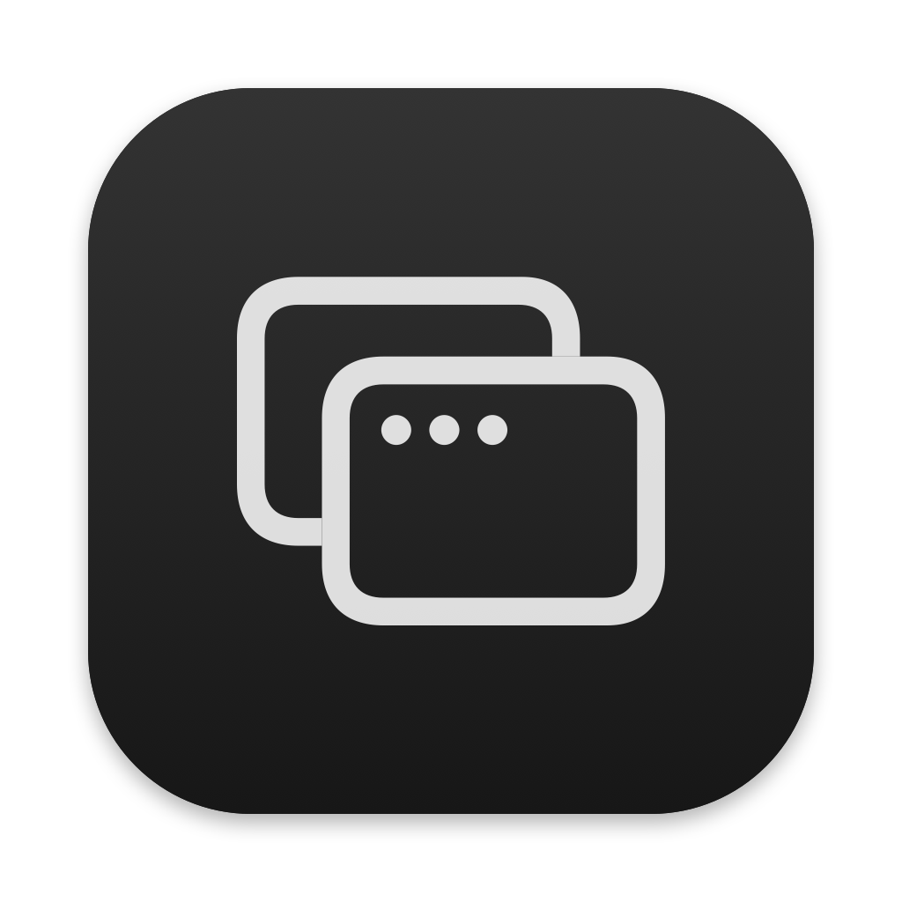

<p align="center">
  
</p>

<h1 align="center">Resizer</h1>

<p align="center">
  Resize any macOS window to the exact resolution you want, right from the menu bar.<br>
  Free and open source.
</p>

---

## Features

- **Any app:** Safari, Chrome, Discord, Finder, VS Code, OBS…
- **Exact resolution:** type width × height (numbers only, capped at your screen's resolution).
- **Presets:** 1280×720, 1920×1080 and more; save your own and delete them with a right-click.
- **Multiple windows at once:** check as many as you like and hit *Apply*.
- **Global shortcut `⇧⌥R`** (Shift + Option + R): applies the current size to the focused window.
- **Center on screen** and **Open at Login**.
- Runs on **Apple Silicon and Intel** Macs, macOS 13 (Ventura) or later.

## Installation

1. Download **`Resizer.zip`** from the [Releases page](../../releases/latest).
2. Unzip it and drag **Resizer.app** into your **Applications** folder.
3. The first time, macOS will block the app because it isn't signed with a paid Apple Developer certificate.
   To allow it, open Terminal and run:
   ```bash
   xattr -dr com.apple.quarantine /Applications/Resizer.app
   ```
   Or try to open the app, then go to **System Settings → Privacy & Security** and click **Open Anyway**.
4. Open Resizer and enable it under **System Settings → Privacy & Security → Accessibility**.
   This permission is what lets it resize other apps' windows.

The icon shows up in the menu bar at the top of the screen.

## Building from source

Requires Xcode (or the Command Line Tools).

```bash
git clone https://github.com/dudssecco/Resizer.git
cd Resizer
./build.sh --install
```

| Command | What it does |
|---|---|
| `./build.sh` | Builds `build/Resizer.app` |
| `./build.sh --install` | Builds and installs to `/Applications` |
| `./build.sh --release` | Builds `dist/Resizer.zip` for publishing |
| `./tools/make_icns.sh` | Regenerates the icon from `tools/make_icon.swift` |

## Limitations

- Some apps enforce their own minimum or maximum window size; Resizer tells you when a window didn't reach the requested size.
- Full-screen windows can't be resized.
- After rebuilding, macOS may ask you to re-enable the Accessibility permission.

## License

[MIT](LICENSE)
